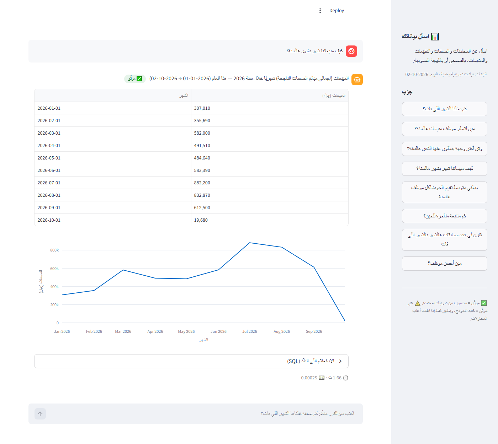
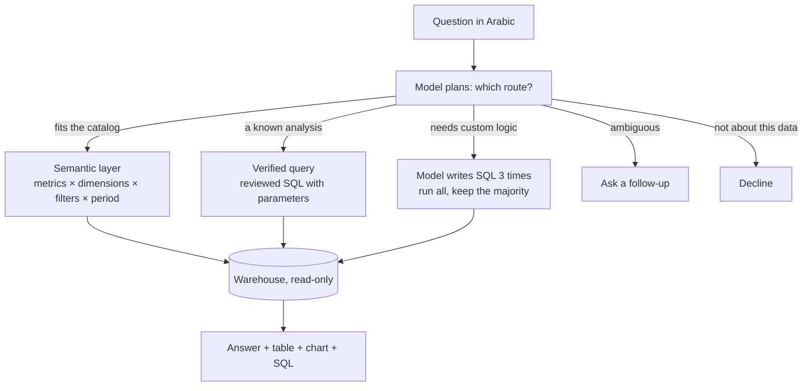
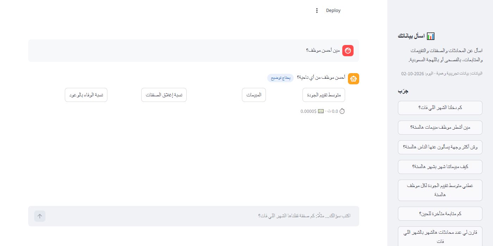
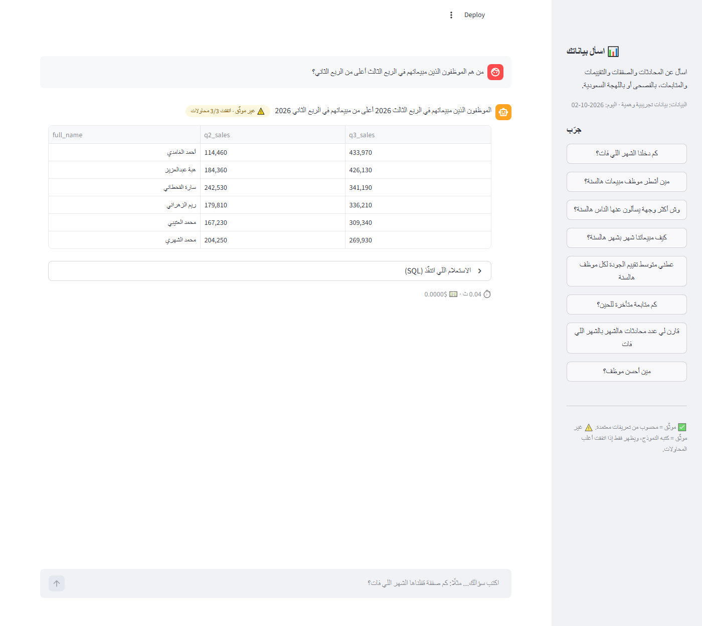

# ask-your-data

Ask a CRM / customer-conversation warehouse questions in Arabic, the way a Saudi manager actually
types them, and get numbers you can trust:

> **كم دخلنا الشهر اللي فات؟** → المبيعات — الشهر الماضي (2026-09-01 → 2026-09-30): **612,500 ريال** ✅

It understands Modern Standard Arabic, Saudi dialect and sloppy spelling, asks when a question is
genuinely ambiguous ("best agent" — by quality score or by sales?), declines what it can't answer,
and shows the SQL behind every number.

**On a frozen 200-question Arabic test set: 97.6% of verified answers correct, 100% of ambiguous
questions answered with a follow-up, 100% of out-of-scope requests declined. Median 2 s and about
$0.0003 per question.** Same score on Postgres built from the production schema.



## Why it's built this way

The obvious way to do this is to hand an LLM the schema and let it write SQL. It works in a demo
and fails quietly in production: the query *runs*, the number *looks* plausible, and it's wrong —
revenue summed over payments instead of won deals, a booking counted twice through a join, the bot
ranked as the best employee. Nobody notices until a decision has been made on it.

So the model mostly doesn't write SQL. The same split that Snowflake Cortex Analyst, Databricks
Genie and Looker use, scaled down:



- **Semantic layer** ([semantic/model.yaml](semantic/model.yaml)) — 31 metrics and 16 dimensions
  with their business rules written once: revenue is won deals by close date, quality scores only
  count usable evaluations and never the bot, a week starts on Sunday. The model picks names;
  [semantic.py](src/ask_data/semantic.py) writes the SQL. Changing what "revenue" means is a
  one-line edit, and every answer follows.
- **Dates are code, not model.** The model says `last_month` or `ramadan_2026`; Python works out
  the dates. LLMs are good at recognising "الشهر اللي فات" and bad at calendar arithmetic.
- **Values are linked, not trusted.** "سارا القحطانى" becomes the stored "سارة القحطاني", "دبى"
  becomes `Dubai`, and "محمد" — two agents share it — becomes a question back to the manager.
- **Free SQL has to win a vote.** For questions the catalog can't express, the model writes three
  independent queries. All three run; the answer is shown only if at least two return the same
  result, and it's labelled ⚠️ unverified. If they disagree, the assistant says so instead of
  picking one.
- **Every query is checked before it runs**: one SELECT, known tables only, no clock functions
  while the demo date is pinned ([guard.py](src/ask_data/guard.py)), on a read-only connection.

| Ambiguous → follow-up | Custom logic → voted SQL, labelled |
|---|---|
|  |  |

## Results

The [test set](eval/test_set.yaml) was written and committed (`8a92f8f`) before any of the
assistant's code existed, and was run once. Tuning used a separate [dev set](eval/dev_set.yaml).
Answers are graded by code, not by a model: the expected SQL runs on the same warehouse and the two
results are compared value by value ([compare.py](src/ask_data/compare.py)).

200 questions, all Arabic: 75 MSA, 75 Saudi dialect, 15 misspelled, 15 multi-step, 10 ambiguous
(must ask), 10 out of scope (must decline).

| | deepseek-flash | deepseek-v4-pro |
|---|---|---|
| **Verified answers correct** (semantic + verified) | **97.6%** (164/168) | 97.6% (164/168) |
| All answers correct | 96.7% (174/180) | 97.8% (175/179) |
| Ambiguous → asked a follow-up | 10/10 | 10/10 |
| Out of scope → declined | 10/10 | 10/10 |
| MSA / Saudi / misspelled | 100% / 96.0% / 100% | 98.7% / 97.3% / 100% |
| Multi-step (model-written SQL) | 80.0% | 86.7% |
| Median / p90 latency | **2.0 s** / 3.6 s | 5.9 s / 12.7 s |
| LLM cost for all 200 questions | **$0.06** | $0.52 |

The bigger model buys nothing on the verified path and a little on hard multi-step questions, at
8× the cost and 3× the latency. **deepseek-flash is the default.**

**Same SQL on the real schema.** The 27 production migrations were applied to an empty Postgres 16,
[scripts/load_postgres.py](scripts/load_postgres.py) copied the demo data in, and the test set was
re-run against it: 97.6% verified, identical answers. That run also caught something the demo
couldn't — in production `interactions.channel` is an ENUM and `deals.source_channel` is text, so a
model-written join between them needs `::text`. The demo had simplified both to text.

### What it got wrong (deepseek-flash, test set)

| Question | What happened |
|---|---|
| وش نسبة المحادثات اللي رد عليها البوت هالشهر؟ | Added a "handled by bot" filter to a metric that already measures the bot → 100% |
| مين أكثر موظف كلم عملاء حارين هالسنة؟ | Ranked the bot as an employee |
| كم بعنا تأشيرات هالسنة؟ | Counted deals instead of summing the amount |
| في أي شهر حققنا أعلى مبيعات؟ | Listed every month instead of ranking them |
| كم عميلًا جديدًا كسبنا معه صفقة خلال 30 يومًا؟ | 232 vs 234: a different reading of "within 30 days" |
| متوسط وقت أول رد للصفقات الناجحة مقابل الخاسرة | **Correct**, graded wrong: it labelled the rows `won/lost`, the expected SQL `S/F` |

The first four are fixed now (the bot is never an employee in rankings, "كم بعنا" means the amount,
"which month had the most" ranks periods, enum casts are in the rules). Those fixes are **not**
re-scored on this test set — tuning on the exam and re-sitting it would make the number meaningless.
A fresh held-out set is the honest way to measure them. One expected answer is also debatable: the
test counts the bot's conversations under "conversations per employee" in one question and excludes
it in another.

## Run it

```bash
python -m venv .venv && source .venv/bin/activate    # Windows: .venv\Scripts\activate
pip install -r requirements.txt
cp .env.example .env                                  # add an OpenAI-compatible key (DeepSeek by default)
python data/generate.py                               # builds data/demo.duckdb (~10 s)

streamlit run app.py                                  # chat UI
python -m ask_data "كم صفقة قفلناها الشهر اللي فات؟"   # or from the terminal
python -m pytest                                      # 50 tests, no API calls
python eval/run_eval.py --set dev                     # score the dev set
```

`MAX_SPEND_USD` in `.env` is a hard stop: every call is priced from its token usage into
`.cache/spend.json` before the next one is allowed. Responses are cached, so re-running an
evaluation costs nothing.

### On a live database

Set `DATABASE_URL` to a Postgres with the same tables and a **read-only** user, and unset `TODAY`.
The assistant opens a read-only session with a statement timeout and the Riyadh timezone. To adapt
it to a different warehouse, edit the `entities` block of
[semantic/model.yaml](semantic/model.yaml) (tables, joins, column expressions) and the verified
queries; the metric names the model sees can stay the same.

## The data

[data/schema.sql](data/schema.sql) is the analytics slice of a Customer-360 warehouse I built for a
travel agency: chats from the CRM, AI analysis of what each customer asked for, a 5-module quality
score for every agent conversation, deals, follow-up promises. Table and column names match
production. **Every row is invented** by [data/generate.py](data/generate.py) — 15,000
conversations, 5,200 customers, 2,900 deals over January–September 2026, with Ramadan, Eid, summer
and National Day peaks — and the seed is fixed, so the expected answers never drift.

## Layout

```
semantic/model.yaml     metrics, dimensions, business rules, named periods
semantic/verified.yaml  reviewed SQL for common analyses
src/ask_data/
  pipeline.py           routes a question; the only place the steps meet
  planner.py prompts.py what the model is asked, and the plan it must return
  semantic.py           YAML -> SQL
  periods.py            "last_month" -> dates
  linking.py            spellings -> stored values, or a follow-up question
  guard.py              read-only, known tables, one statement
  compare.py            do two results say the same thing (voting and grading)
  warehouse.py          DuckDB demo / live Postgres, same SQL
  llm.py                cache + spend cap
eval/                   test set (frozen), dev set, runner, results
app.py                  Streamlit chat UI
```

## Limits

- The data is synthetic. Real questions will find gaps in the catalog; the question log
  (`logs/questions.jsonl`) is where the next metrics come from.
- Model-written SQL (the ⚠️ path) was right 10 times out of 12 on the test set. The vote stops
  random mistakes, not a shared misreading of the question — that's why it's labelled.
- The same person wrote the test set and the verified queries, so the verified path's 10/10 is
  less independent than the rest.
- Arabic only was tested. English questions work but weren't measured.
